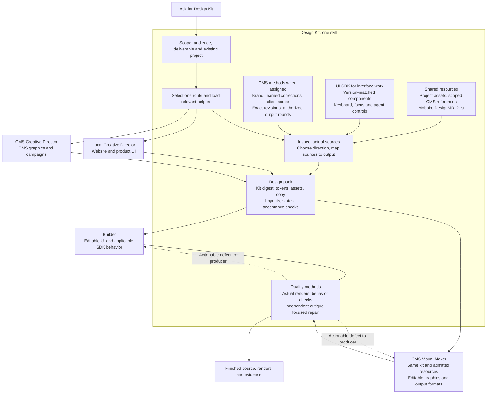

# How Design Kit works

The entry file states the rules; this diagram shows the flow. The producer is the maker or builder.

Provider retrieval is targeted, not a required checklist. CMS account effects, publication and scheduling require their own task authority.
