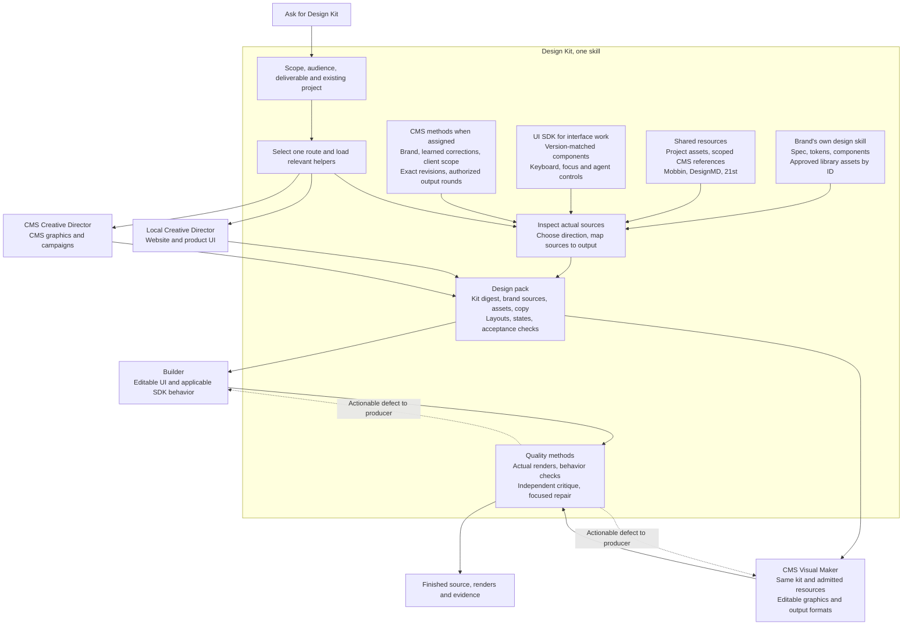

# How Design Kit works

The entry file states the rules; this diagram shows the flow. The producer is the maker or builder.

Provider retrieval is targeted, not a required checklist. CMS account effects, publication and scheduling require their own task authority.

## One job, from request to recommendation

Every creative job follows this order on every host. A person does not carry
results between stages; the role finishing a stage hands the next role its
work order.

| Stage | Owner | Leaves behind |
| --- | --- | --- |
| 1. Intake | The host that received the request | One job record: the ask in the person's words, the client, the deliverables and their kinds, the destination and what the job may change |
| 2. Brief and brand | Director | The brief, the resolved brand record, and for CMS work the learned record read |
| 3. Direction | Director | A checked design pack per deliverable kind |
| 4. Production | The producer for the medium in [mediums.md](mediums.md) | Editable source, renders, the source-to-output record, defects seen |
| 5. Critique | Critic | Graded findings and a verdict on the actual output |
| 6. Repair | The same producer | Changed output with before and after; two rounds at most |
| 7. Recommendation | Director | One recommendation with reasons, visual and copy together, and the list of decisions that belong to a person |
| 8. Decision | A person | Keep, reject, pick or request changes, with a reason where they give one |
| 9. Learning | The host that records outcomes | Each decision recorded where the next job for that client will read it |

Rules that hold at every stage:

- Stages 3, 4 and 5 are three different roles on substantial work. A small
  edit may skip to stage 4 with a proportionate check.
- The pack is the only handoff into production and into critique. A producer
  or critic that receives anything else asks for the pack.
- The Director assembles stage 7 even when the critic's verdict is strong.
  Nobody else recommends, and no agent decides.
- Stage 8 is the only sign-off. An agent's review, a passing check and a
  finished render are not acceptance.
- Stage 9 is part of the job. A job whose decisions were not recorded is not
  finished, because the next job starts from the same mistakes.
- Publishing and scheduling are separate jobs with their own authority.
